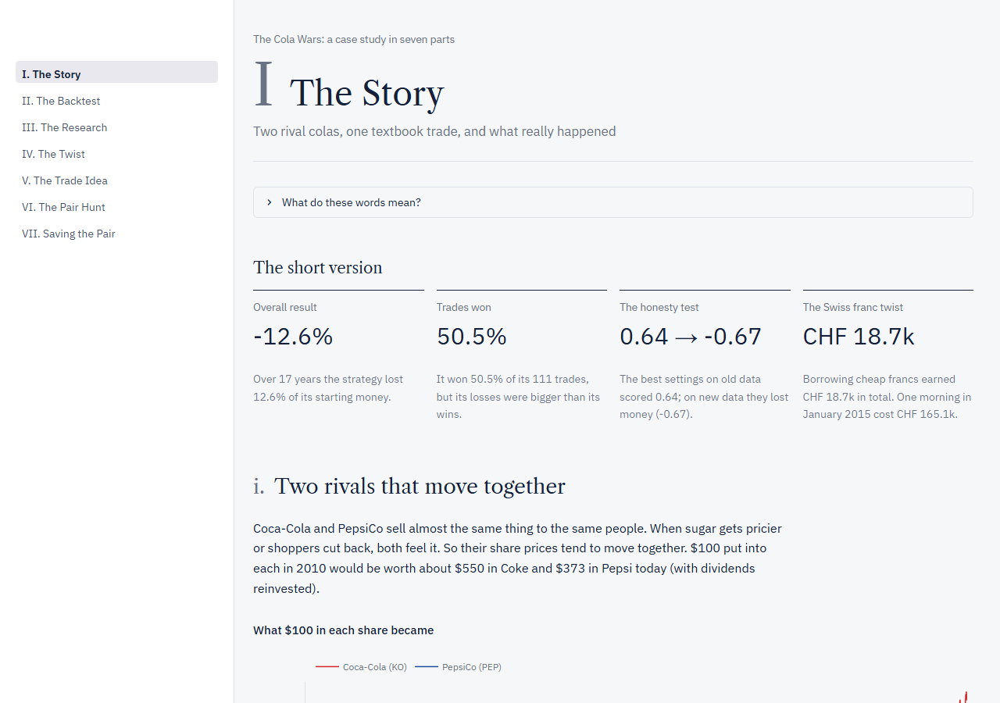
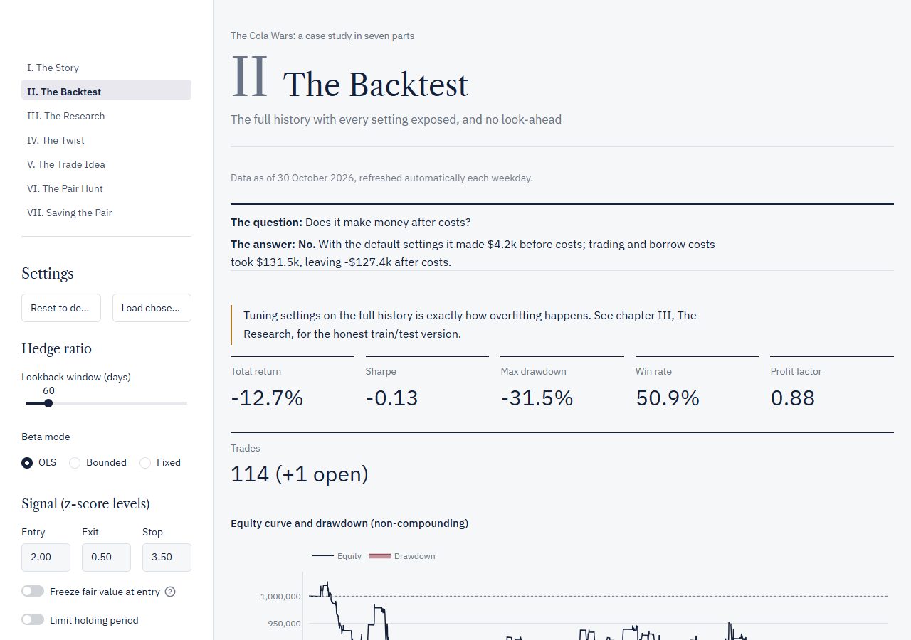
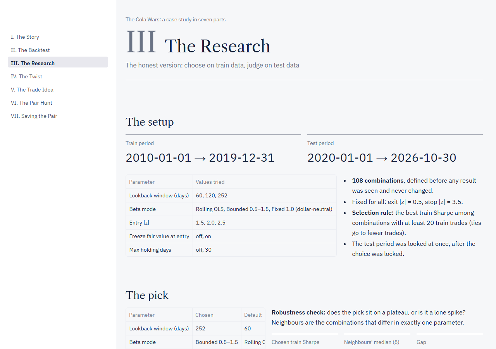
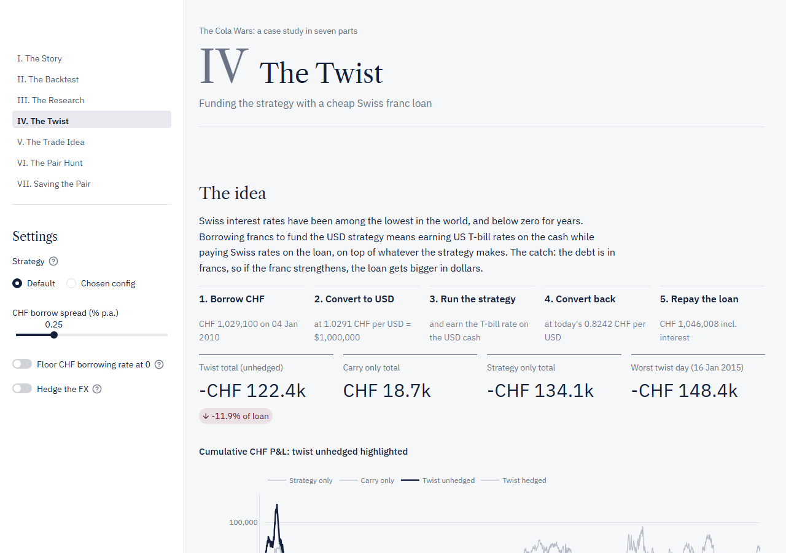
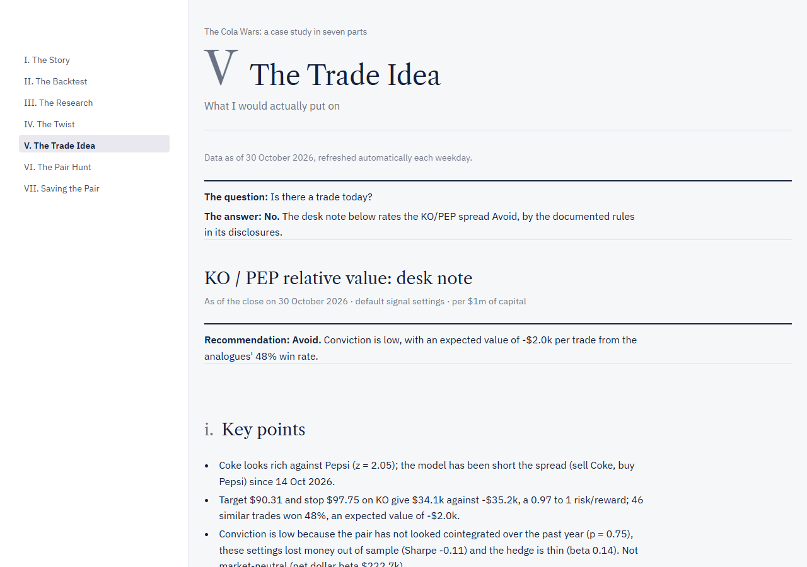
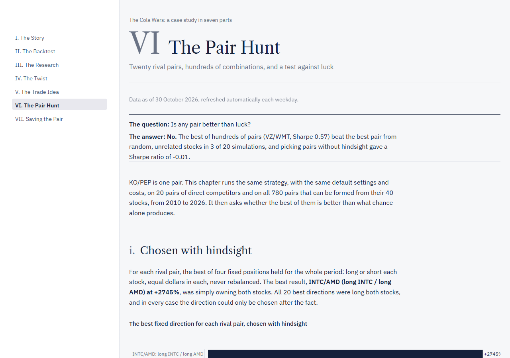
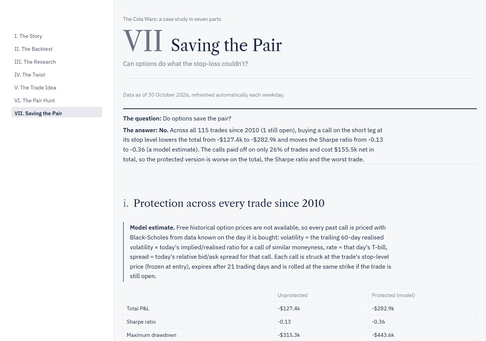

# The Cola Wars: a KO/PEP pairs-trading case study

[](https://github.com/Li52utm/ko-pep-pairs-trading/actions/workflows/tests.yml)
[](https://github.com/Li52utm/ko-pep-pairs-trading/actions/workflows/refresh-data.yml)

A textbook pairs trade between Coca-Cola and PepsiCo, tested honestly: no look-ahead, realistic
costs, out-of-sample research, a test against luck, and a Streamlit dashboard in seven chapters.

**Live demo:** [https://YOUR-APP.streamlit.app](https://YOUR-APP.streamlit.app)



## The question

Coca-Cola and PepsiCo sell similar products to the same customers, and their share prices tend
to move together. The textbook trade: when one runs ahead of the other, sell the expensive one,
buy the cheap one, and wait for the gap to close. **Does the textbook KO/PEP pairs trade actually
work once it is tested honestly?**

<!-- AUTO:START -->
## Key findings

All numbers are from data to **10 November 2026** (daily closes from 4 January 2010), default settings, $1m of capital, 5 bps per leg in transaction costs and 0.5% a year short borrow. This block is regenerated by `scripts/update_readme.py` after every data refresh.

- **A winning record can still lose money.** The strategy won 50.9% of its 114 trades but lost 14.9% overall (Sharpe -0.16): the average loss ($17.2k) was larger than the average win ($14.6k).
- **The best research setting collapsed out of sample.** Of 108 settings ranked on 2010–2019 only, the best scored a Sharpe of 0.65 in training and -0.67 on 2020–2026. Only 6 of 108 settings had a positive test Sharpe, and the train ranking was negatively correlated with the test ranking (Spearman -0.30).
- **KO/PEP is not special, and the best pair looks like luck.** KO/PEP ranked 539 of 780 possible pairs among 40 large US stocks. The best pair (VZ/WMT, Sharpe 0.57) beat the best pair found in markets of random, unrelated stocks in only 4 of 20 simulations.
- **Chosen without hindsight, the strategy did not beat cash.** A walk-forward version that picks cointegrated pairs on the past year and trades them for six months lost 7.1% on 20 rival pairs (Sharpe -0.21) and lost 3.0% on all 780 pairs (Sharpe -0.04).
- **Cheap Swiss franc funding hid a large tail risk.** Funding the trade with a franc loan earned CHF 13.8k of carry over the whole period; the Swiss National Bank's removal of the EUR/CHF floor cost CHF 165.1k on a single day in January 2015, about 11 years of the average interest income.
- **Do options save the pair? Partly.** Each stop-loss lost $6.1k more on average than a fill at the stop (worst $47.0k). Across all 115 trades since 2010 (1 still open), buying a call on the short leg at its stop level lowers the total from -$148.8k to -$186.9k and moves the Sharpe ratio from -0.16 to -0.23 (a model estimate). Protection improves the worst trade (-$88.6k to -$70.6k), but the strategy still loses money: insurance limits the damage, it does not create an edge. This uses the sensible-strike rule: a short leg whose stop-level strike is outside 0.80x to 1.25x spot at entry is not protectable at the stop level and gets no call, which affects 4 trades. With a call on every trade (the original rule) the protected total is -$191.4k instead of -$186.9k.

Automated tests: **179** (pytest, offline), run on every push and before every data refresh is committed.
<!-- AUTO:END -->

## The seven chapters

Every chapter opens with its question and an answer generated from the current data.

| | Chapter | The question | What it shows |
|---|---|---|---|
|  | **I. The Story** | Does the textbook pair trade work? | The whole case study in plain English for a non-finance reader, every number generated live. |
|  | **II. The Backtest** | Does it make money after costs? | The full history with every setting adjustable, trade log, execution lag and stop slippage; market neutrality against the S&P 500, monthly returns, rolling Sharpe, VaR, a data-quality table and a one-page PDF tear sheet. |
|  | **III. The Research** | Does tuning the settings help? | 108 settings chosen on 2010–2019 and judged on 2020 onwards; robustness and cost sensitivity. |
|  | **IV. The Twist** | Does cheap Swiss franc funding help? | Funding the strategy with a Swiss franc loan: carry, FX, the 2015 SNB shock, and a hedge. |
|  | **V. The Trade Idea** | Is there a trade today? | A sell-side style desk note from the latest close: recommendation, the trade, risk/reward, a scenario grid, market exposure, catalysts, liquidity, risks and disclosures. |
|  | **VI. The Pair Hunt** | Is any pair better than luck? | 20 rival pairs and 780 data-mined pairs, a test against luck, and a walk-forward version. |
|  | **VII. Saving the Pair** | Do options save the pair? | A protective call priced on every historical trade (a model estimate), put-call parity in today's option prices, and three ways to hold the short leg. |

## Methodology highlights

- **No look-ahead.** The hedge ratio and z-score on day t use only days t−60 to t−1; a signal at
  day t's close is traded at day t+1's close. A test scrambles every price after a cut-off date
  and checks that nothing before it changes (`tests/test_signals.py::test_no_look_ahead`); the
  walk-forward has the same test for its pair selection.
- **Realistic costs.** 5 bps per leg on every entry and exit, 0.5% a year borrow on the short leg,
  and a non-compounding P&L on fixed capital.
- **Train/test with a fixed grid.** The 108 settings were fixed before any results were seen,
  ranked on 2010–2019 only, and the chosen one judged once on 2020 onwards. Neighbouring settings
  are checked to flag isolated "lucky spike" results.
- **Corrections log.** Every correction to the backtest is recorded with the date, what was wrong,
  why, the fix and before/after numbers, alongside measured effects that are deliberately kept
  (stop slippage, execution lag): see [docs/METHODOLOGY.md](docs/METHODOLOGY.md).
- **Validated data.** Eight checks against independent sources before every refresh is written: a second
  price source (Nasdaq), a total-return rebuild from dividends and splits, the NYSE calendar, every move
  above 8%, dividends per year, USD/CHF against FRED, interest-rate ranges and the option quotes. Any FAIL
  stops the refresh; results in [docs/DATA_VALIDATION.md](docs/DATA_VALIDATION.md).
- **Market neutrality measured.** Daily strategy returns are regressed on the S&P 500 with Newey-West
  errors, for the full sample and the test period.
- **Tested.** An automated pytest suite, including hand-calculated examples, the look-ahead tests,
  a saved reference output for the signals, and Black-Scholes checks for the option code.

## Project structure

```
app.py                      Streamlit router: the seven chapters in order
chapters/                   One file per dashboard chapter (1_story.py ... 7_saving_the_pair.py)
src/
  data.py                   Prices (Yahoo Finance) and interest rates (FRED): snapshot reads, downloads for the refresh
  validation.py             The eight data checks (PASS / WARN / FAIL)
  signals.py                Rolling hedge ratio, z-score and the entry/exit/stop state machine
  backtest.py               Day-by-day simulation with costs, borrow and execution lag
  metrics.py                Returns, trade statistics, costs, exit slippage, market regression, VaR
  tearsheet.py              The one-page PDF tear sheet (fpdf2)
  research.py               Fixed parameter grid, train/test selection, cost sensitivity
  carry.py                  The Swiss franc carry twist (Chapter IV)
  trade_idea.py             The desk note calculations (Chapter V)
  universe.py, pair_hunt.py The rival-pair universe, luck baseline and walk-forward (Chapter VI)
  options.py                Option snapshot, parity, structures, historical protection model (Chapter VII)
  ui.py                     Dashboard helpers: caching, formatting, theme and charts
scripts/refresh_snapshots.py  Refreshes every committed snapshot and result file
scripts/validate_data.py    Runs the data validation (also called by the refresh)
results/                    Committed results and data snapshots the dashboard reads
tests/                      pytest suite (and a saved reference fixture)
docs/                       METHODOLOGY.md, DATA_VALIDATION.md and the screenshots
.streamlit/config.toml      Theme (colours and fonts)
```

## How to run locally

Developed and tested on Python 3.14 (versions pinned in `requirements.txt`).

**Windows (PowerShell)**

```
python -m venv .venv
.venv\Scripts\python -m pip install -r requirements.txt
.venv\Scripts\streamlit run app.py
```

**macOS / Linux**

```
python3 -m venv .venv
.venv/bin/python -m pip install -r requirements.txt
.venv/bin/streamlit run app.py
```

The dashboard opens at http://localhost:8501. It reads only the snapshots committed in `results/`
(it never downloads on a page load) and shows their as-of date under every chapter heading.

**Tests**

```
.venv\Scripts\python -m pytest        # Windows
.venv/bin/python -m pytest            # macOS / Linux
```

**Refreshing the data and results**

```
.venv\Scripts\python scripts\refresh_snapshots.py      # Windows
.venv/bin/python scripts/refresh_snapshots.py          # macOS / Linux
```

This downloads prices (KO, PEP, SPY), rates, the 40-stock universe, the KO and PEP option chains,
daily volumes and the next earnings and ex-dividend dates, checks every download, validates the data
against independent sources (`scripts/validate_data.py`), writes the snapshots in `results/`, re-runs `src/research.py` and `src/pair_hunt.py`
(about 7 minutes) and regenerates the key findings above (`scripts/update_readme.py`). Normally
the scheduled GitHub Action does this for you (see Data pipeline).

## Data pipeline

The dashboard never downloads anything when a page loads: every chapter reads the snapshots
committed in `results/`, and shows their as-of date ("Data as of …, refreshed automatically each
weekday") under the chapter heading. Freshness comes from a scheduled GitHub Action:

- **Schedule:** `.github/workflows/refresh-data.yml` runs at 22:30 UTC every weekday (after the
  US close in both winter and summer time), and can also be started by hand from the Actions tab.
- **What it does:** runs `scripts/refresh_snapshots.py` (download, check, validate, write snapshots, re-run
  the research and the pair hunt, regenerate the key findings), then runs the full test suite
  offline. Only if the tests pass and something changed does it commit
  `Data refresh: as of YYYY-MM-DD` as the github-actions bot and push.
- **On failure:** if any download fails or looks wrong (empty, fewer rows than the committed
  snapshot, a missing stock price, every option bid zero) or any data validation check is FAIL, the
  script stops before writing anything; if the tests fail, nothing is committed. Either way the job fails (the badge turns red)
  and the dashboard keeps serving the last good snapshot. Each chapter warns when the data is more
  than 7 calendar days old, and chapter VII warns when the option snapshot has expired.
- **Tests:** `.github/workflows/tests.yml` runs the full suite on every push and pull request.

## Limitations

- Daily closing prices only: no intraday data, so stops are checked at the close and can gap.
- Survivorship bias: the universe is 40 large companies that exist today, and the 20 rival pairs
  were chosen by hand with hindsight.
- The Swiss franc twist uses an idealised daily FX hedge and approximate day counts; the FX data
  is slightly stale relative to the US close.
- Free historical option prices are not available, so the options chapter's history is a model
  estimate (Black-Scholes from trailing realised volatility, scaled by today's implied/realised ratio
  and spreads); today's structures use a single-day snapshot, and dividends are projected estimates.
- The second price source (Nasdaq) covers only the last ten years, so 2010-2016 prices are checked
  by the total-return rebuild, the calendar and the large-move rules, not by a second source.
- Full details in the Known limitations of `CLAUDE.md` and in [docs/METHODOLOGY.md](docs/METHODOLOGY.md).

## Built with

Python, pandas, statsmodels, Streamlit and Plotly (with NumPy, SciPy, yfinance, pandas_market_calendars
and fpdf2).

Developed with AI pair-programming (Claude Code); methodology decisions, reviews and corrections
are documented in [docs/METHODOLOGY.md](docs/METHODOLOGY.md).

## Disclaimer

An educational project. Nothing here is investment advice.

## Author

Labeeb ([LinkedIn](YOUR-LINKEDIN-URL)).

Licensed under the MIT License (see [LICENSE](LICENSE)).
